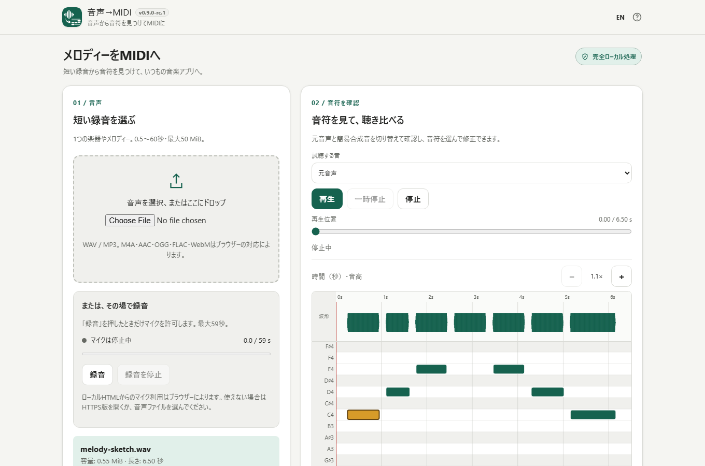

# 音声→MIDI / Audio to MIDI

Spotify Basic Pitchで短い録音から音符を検出し、端末内だけでMIDIへ変換します。

## 主な機能

- 音声ファイル1つ、0.5〜60秒・最大50 MiB
- WAV/MP3と、ブラウザーが対応するM4A/AAC/OGG/FLAC/WebM
- マイク録音、音量表示、停止・試聴・破棄と元音声の任意保存
- スマートフォン向け「入力・音符・保存」ページタブ
- CPUによる端末内解析、進捗表示、即時キャンセル
- ピアノロールと波形の可視範囲描画、拡大・スクロール・選択音符の時刻表示
- 小区間に分けた推論と、完了後の端末内モデル再利用
- 音符の追加・削除、半音/時刻の修正、音名/秒数の直接入力、最大100操作のUndo/Redo
- 検出感度3種と、しきい値・最短長さ・音域の詳細設定
- 音符の分割・結合、短音削除・任意の秒単位グリッド補正をプレビューして適用
- 元音声/簡易合成音の聴き比べ、再生・一時停止・停止・シーク
- 保存名の編集、標準MIDIタイプ1と秒数を保つCSV音符表の出力
- 日本語/英語、PC/スマートフォン向けの明色UI

## 使い方

1. [アプリを開く](https://ttomohisa.github.io/htmlapps-audio-to-midi/)。オフラインでは、ダウンロードした `audio-to-midi.html` または `dist/index.html` を開きます。
2. 短い音声ファイルを選ぶか、「録音」を押してマイクを許可します。「録音を停止」して試聴してから解析してください。録音は最大59秒、ファイル入力は最大60秒です。
3. 「音声を解析」を押します。速度は端末によります。
4. 元音声と音符の合成音を聴き比べ、拡大・スクロール・音符選択で確認し、音程や時刻を修正します。追加・削除・Undo/Redoも使えます。
5. 音楽アプリ用ならMIDI、秒数を保つ音符表ならCSVを選び、保存名を編集して保存します。
6. 音楽アプリで採譜結果を確認してください。

## プライバシー

音声・音符・推論はブラウザー内で完結し、外部送信や解析時のダウンロードはありません。保存する設定は言語のみです。ページを再読み込み・終了すると音声と音符は失われます。

## 対応環境・制限

**バージョン1.0.0**。正式版の対象はWeb Audio・Worker・DecompressionStream対応のWindows・AndroidのChromeです。2026-10-18に利用者から確認OKと次段階への承認を受けました。最終4項目の個別結果は申告されていません。[リリース判断と検証範囲](docs/RELEASE_CHECKLIST.md)を参照してください。公開には最終CIと利用者によるマージが必要です。他のOS／ブラウザー、DAW再生、読み上げ支援は未検証です。Firefox/WebKitの自動試験を実機合格とは扱いません。

採譜は推定です。複数楽器の楽曲、雑音、倍音などで誤検出があります。MIDIは音声ではありません。時間を保持するための固定120 BPM、チャンネル1、ピアノ音色0、ベロシティ96で保存します。テンポ・強弱は推定せず、ピッチベンドも出力しません。

ごく小さな雑音でも音符が出ることがあります。余計な音符が多いときは、検出感度を「少なめ」にして再解析を試してください。必要な弱い音や短い音も見落とす可能性があるため、元音声と聴き比べます。[合成雑音の測定記録](docs/NOISE_CHARACTERIZATION.md)は測った入力の結果であり、他の録音での効果を保証するものではありません。

音符を選んで近くのボタンや直接入力で修正できます。C4はMIDI 60、時刻ボタンは0.05秒刻みです。追加すると再生位置にC4を置きます。追加・削除・変更のUndo/Redoは最大100操作です。入力欄以外ではCtrl/⌘+ZとCtrl/⌘+Shift+Zも使えます。検出感度「少なめ・標準・多め」と、詳細のしきい値・最短長さ・音域を選べます。設定は解析時に適用し、再解析の失敗・中止では前の結果と履歴を保持します。選択音符を分割したり、同じ音高で間隔0.05秒以内の隣接音符を結合できます。短い音符の削除と秒単位グリッド補正は変更前後をプレビューして適用し、まとめて1回のUndoで戻せます。グリッド補正は初期OFFで、テンポは推定せず、不正な結果は変更しません。未保存の音符編集を再解析や入力変更で破棄する前に確認します。録音にはMediaRecorderとブラウザーが録音・デコードできる形式が必要です。許可の拒否、マイク未接続、録音非対応でもファイル変換は使えます。ローカルHTMLでマイクを使えない場合はHTTPS版をご利用ください。簡易合成音は元の楽器の音色を再現しません。ページが非表示になると再生を一時停止し、録音を停止します。停止時にマイクを解放し、録音中の音声をスピーカーには流しません。未保存の録音を入力変更やリセットで破棄する前に確認します。終了や再読み込みでデータは失われ、スマートフォンでは警告が出ない場合があります。表示・簡易合成音・MIDI/CSV保存には編集後の音符を使います。

解析中にページを隠すと処理を中止します。戻ってから明示的に解析し直してください。再解析を中止しても前の完成済み音符は保持します。実機の性能ゲートは未完了のため、入力上限は60秒を維持しています。

同じ音高の重なったMIDI音符は音楽アプリによって長さの解釈が異なる場合があります。CSVは各音符の開始・終了秒数をそのまま保持します。CSV/MIDIのどちらにも元音声は含みません。

10/30/60秒の合成音源に対するNode CPUの実測時間とTensor計測は[性能検証記録](docs/ACCEPTANCE_RESULTS.md#performance-evidence)に掲載しています。ブラウザーや実端末の最大メモリ・速度保証ではありません。ファイル全体のデコードには圧縮ファイル容量を大きく超えるメモリが必要な場合があります。余裕のない端末では短い音声を使ってください。

## 単一HTML・オフライン

ビルドは `dist/index.html`、同一内容の `audio-to-midi.html`、自己展開版 `dist/index.self-extract.html` を生成します。モデル・ランタイム・Worker・ライセンスも内包し、配布後のサーバーは不要です。資産を圧縮しているため両版ともDecompressionStream対応が必要です。

## 開発

[AGENTS.md](AGENTS.md)・[APP_SPEC.md](APP_SPEC.md)を先に確認してください。[開発計画](docs/DEVELOPMENT_PLAN.md)と[受け入れマトリクス](docs/ACCEPTANCE_MATRIX.md)はv0.1〜v1.0を対象にしています。

Windowsでは `build-standalone.bat` を実行します。PowerShellの構文検査と `scripts/check-repository.ps1` が正式なビルド検証です。Node 24で `npm ci --ignore-scripts`、`npm test`、`npm run test:model`、Chromium導入後に `npm run test:browser` を実行できます。任意の `npm run test:performance` は実モデルの10/30/60秒比較と100回の短時間解析・中断を測定し、数分かかることがあります。推論テストには通常ビルドで検証したパッケージキャッシュが必要です。

生成HTMLは直接編集せず、`src/`から再ビルドしてください。

## ライセンス

アプリはMIT。Basic Pitchとモデル、TensorFlow.jsはApache-2.0、Tonejs MIDIはMITです。[第三者告知](THIRD_PARTY_NOTICES.md)とアプリ内ヘルプの全文を参照してください。
