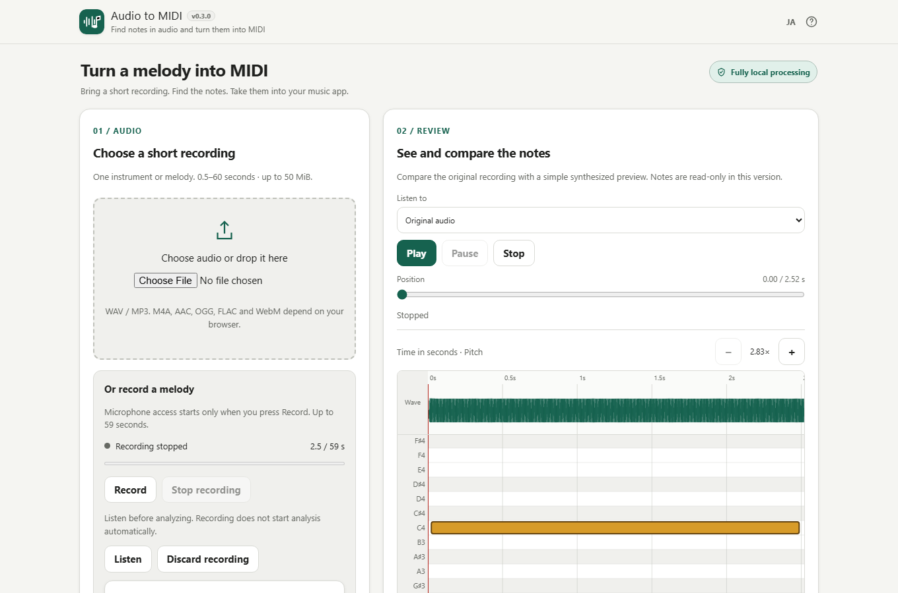

# Audio to MIDI

Convert a short recording into MIDI using Spotify Basic Pitch, entirely on your device.



## Features

- One audio file, 0.5–60 seconds and up to 50 MiB
- WAV/MP3, plus M4A/AAC/OGG/FLAC/WebM when your browser can decode them
- Microphone recording with a level meter, Stop / Listen / Discard, and optional original-audio download
- Input / Notes / Export page tabs on smartphones
- On-device CPU inference, progress and immediate cancellation
- Visible-range piano roll/waveform rendering, zoom, scrolling and selectable note timing
- Bounded inference windows and local model reuse after successful runs
- Preview note split/merge, short-note removal and optional seconds-grid correction; each batch has Undo
- Three detection presets and validated advanced threshold, duration and pitch-range settings
- Manual note add/delete, semitone and timing correction, direct pitch/second entry, and 100-operation Undo/Redo
- Original-audio / simple-synth comparison with play, pause, stop and seek
- Editable filename, standard MIDI type 1 and exact-seconds CSV note-table export
- Japanese/English, responsive light interface

## How to use

1. Open the generated `audio-to-midi.html` or `dist/index.html`.
2. Choose a short audio file, or press **Record** and allow microphone access. Press **Stop recording**, then **Listen** before analyzing. Recording is limited to 59 seconds; file input allows up to 60 seconds.
3. Press **Analyze audio**. Processing speed depends on your device.
4. Compare **Original audio** and **Synthesized notes**, then zoom/scroll and select a note to correct its pitch or timing. Add missing notes or delete unwanted notes; Undo/Redo restores changes.
5. Choose **MIDI** for your music app or **Note table (CSV)** for exact note times, edit the filename, then Download.
6. Open the MIDI in a music app to review the transcription.

## Privacy

Audio, notes and model inference stay in your browser. There are no runtime downloads, analytics or uploads. Only your language choice is saved. Reloading or closing the page loses the audio and notes.

## Browser support and limits

This is the **v0.8 development milestone**. Chrome/Edge/Firefox/Safari with Web Audio, Workers and DecompressionStream are target browsers. Real Windows, Android and iOS device acceptance is not yet complete; see [verification](docs/VERIFICATION.md).

Transcription is approximate. Mixed songs, noise and harmonics can create wrong notes. MIDI is note data, not audio. Output uses 120 BPM only to preserve seconds, channel 1, piano program 0 and fixed velocity 96. No tempo/loudness estimation or pitch bends. Same-pitch overlapping MIDI notes can be interpreted differently by music apps; CSV preserves each exact start/end interval.

Select a note and correct it with nearby buttons or direct fields. C4 is MIDI 60; timing buttons step by 0.05 seconds. Add inserts a C4 note at the playback position. Undo/Redo retains up to 100 operations. Ctrl/⌘+Z and Ctrl/⌘+Shift+Z work outside text fields. Choose Fewer/Standard/More sensitivity or expand advanced thresholds, minimum length and pitch range. Settings apply only on Analyze; failed or cancelled reanalysis keeps the previous result and history. Split inside a selected note or merge eligible same-pitch neighbors within 0.05 seconds. Cleanup previews short-note removal and optional seconds-grid correction before Apply; each batch is one Undo step. Grid correction starts off, does not infer tempo and skips invalid results. Unsaved edits require confirmation before reanalysis or audio replacement. Recording requires MediaRecorder and a browser-supported, locally decodable format. If permission is denied, no microphone is present, or recording is unsupported, file conversion remains available. Local-file microphone access varies; use the HTTPS app if needed. The simple synth does not reproduce the original instrument. Playback pauses, recording stops and active analysis is cancelled when the page is hidden. Return and explicitly Analyze to restart; a completed previous result is retained. Stop releases all microphone tracks; there is no live speaker monitoring. Unsaved recordings require confirmation before replacement/reset. Closing or reloading loses session data; mobile browsers may omit the exit warning. Edited notes are used immediately for display, synthesized playback and MIDI export.

## Offline single HTML

The normal build produces `dist/index.html`, a byte-identical root `audio-to-midi.html`, and `dist/index.self-extract.html`. Model, runtime, worker and licenses are embedded. No server is needed after download. Both variants currently require DecompressionStream because assets are compressed.

## Development

Read [AGENTS.md](AGENTS.md) and [APP_SPEC.md](APP_SPEC.md). The supplied [development plan](docs/DEVELOPMENT_PLAN.md) and [acceptance matrix](docs/ACCEPTANCE_MATRIX.md) cover v0.1–v1.0.

Windows: run `build-standalone.bat`. Or use PowerShell:

```
./scripts/check-powershell-syntax.ps1
./scripts/check-repository.ps1
```

Node 24 test workflow:

```
npm ci --ignore-scripts
npm test
npm run test:model
npm run test:performance # Optional long CPU stress/benchmark gate
npx playwright install chromium
npm run test:browser
```

Inference/model tests require the standard build's verified package cache. The optional performance gate writes a detailed JSON report under `test-results/` and can take several minutes. Development sources are split into pure contracts, worker inference and UI; the PowerShell builder assembles them into one HTML. Never hand-edit generated files.

## License

App: MIT. Basic Pitch/model and TensorFlow.js: Apache-2.0. Tonejs MIDI: MIT. See [third-party notices](THIRD_PARTY_NOTICES.md); full runtime licenses are available in the app's help.
